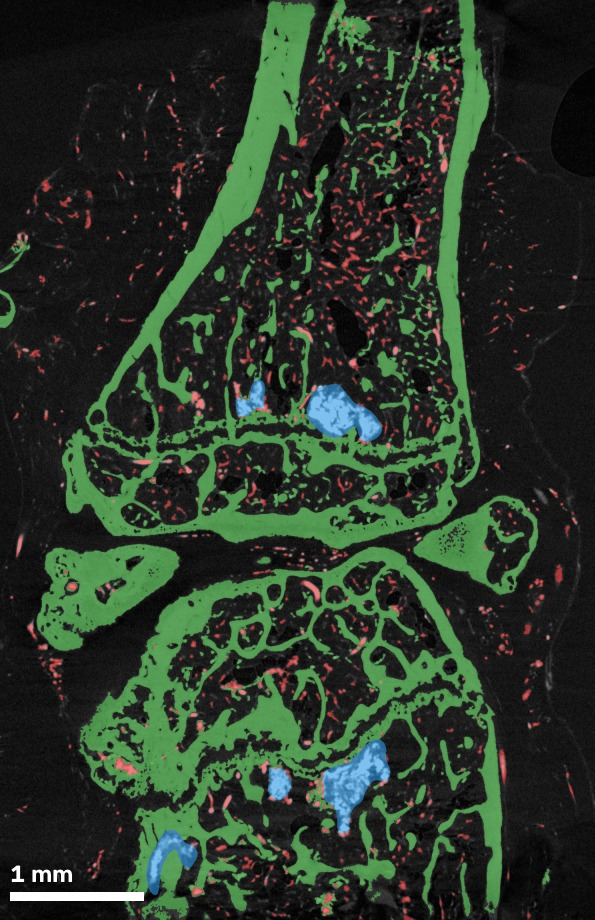
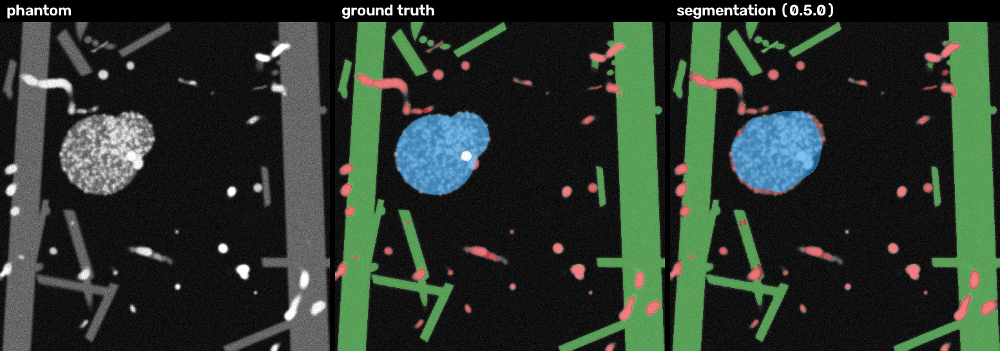
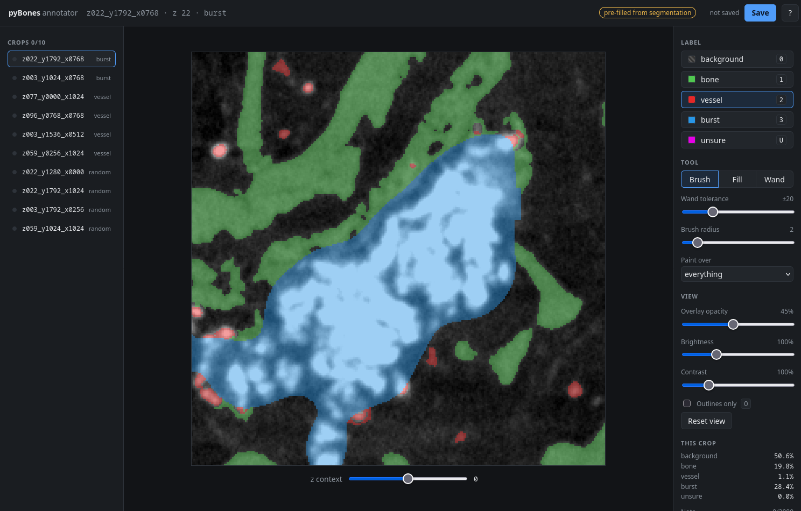

# pyBones

Back in 2018, during my engineering degree, a group project for the SAINBIOSE laboratory (Saint-Étienne)
asked us to analyse the blood vessels inside bone: a mouse knee, perfused with a radio-opaque contrast
agent (barium sulfate), scanned by micro-CT. Our answer was a Matlab segmentation script and a PyQt5
viewer. The [report](docs/report/report.pdf) summarises it, and the masks it produced are kept as the
2018 baseline in [docs/report/2018/](docs/report/2018/).

pyBones is that project, finished properly: a pure-Python rewrite (numpy + OpenCV) that splits every
voxel of the scan into **bone**, **vessel** and **burst** (contrast agent that leaked out of vessels
damaged by freezing), resolves what 2D slices cannot decide with 3D reasoning, and exports surface
meshes. With no expert annotation available, it is validated on a synthetic phantom with exact ground
truth, calibrated on the real scan.

The whole story (what the 2018 project did, what changed, why, and what is still out of reach) is in
the [report](docs/report/report.pdf).

## SCREENSHOTS

One slice of the knee (distal femur on top, proximal tibia below), segmented: bone in green, vessels in
red, bursts in blue:



The vessel network of the whole stack seen from above, coloured by depth:


The same marrow region, as segmented in 2018, by the first Python port, and today:


The synthetic phantom used for validation: image, exact ground truth, segmentation:



A local annotation page, ready for whoever can provide expert labels:



## VERSION

The current version lives in [pyproject.toml](pyproject.toml) and is read from package metadata at
runtime (and recorded in every segmentation's `meta.json`). See [CHANGELOG.md](CHANGELOG.md) for the
full version history.

## TABLE OF CONTENT

<!-- TOC -->

- [pyBones](#pybones)
  - [SCREENSHOTS](#screenshots)
  - [VERSION](#version)
  - [TABLE OF CONTENT](#table-of-content)
  - [TL;DR](#tldr)
  - [INSTALLATION](#installation)
  - [HOW IT WORKS](#how-it-works)
  - [VALIDATION](#validation)
  - [PROJECT LAYOUT](#project-layout)
  - [KNOWN LIMITATIONS](#known-limitations)
  - [POSSIBLE FUTURE UPDATES](#possible-future-updates)
  - [LICENSE AND DATA](#license-and-data)

<!-- /TOC -->

## TL;DR

"I just want to see it work." With [uv](https://docs.astral.sh/uv/) and `data_set.zip` at the root:

```sh
uv sync
uv run pybones segment data_set.zip -o output/run
uv run pybones preview output/run -z 50 --scale 0.5 -o slice50.png
uv run pybones mesh output/run --label vessel -o vessels.stl
```

`pybones` (or `python -m pybones`) is the single entry point; see `pybones --help`.

To drive it from a web browser instead, start the local server (it reads its stacks from `data/`):

```sh
mkdir -p data && ln -s ../data_set.zip data/    # Windows: copy data_set.zip into data\
uv run pybones serve
```

Then open **<http://127.0.0.1:8000>** in a browser (Ctrl+C in the terminal stops the server). For now
it leads to the interactive API documentation (FastAPI's Swagger UI), also reachable directly at
**<http://127.0.0.1:8000/docs>**: every request is listed there with its parameters and answers, and
can be tried with "Try it out". The web page with the slice and 3D viewers is the next step. Details:
[INSTALL.md](INSTALL.md#web-server).

## INSTALLATION

Prerequisites per OS (Debian/Ubuntu, Arch Linux, Windows), installation with uv or pip, the dataset,
every command, the tools and how to build the report: [INSTALL.md](INSTALL.md).

## HOW IT WORKS

1. **Thresholds**: one 3-class Otsu (soft tissue / bone / contrast agent) for the whole stack.
2. **Per slice** (threaded, streamed): vessels are bright cores plus their partial-volume rim, cut at
   a local half-maximum against the surrounding material (sought in 3D); the glow below it is not bone.
   Bursts are areas dense in bright pixels, measured per slice and in a 3D box, bounded at half the
   core density. Small bone-intensity blobs, undecidable in 2D, are marked ambiguous.
3. **Tubularity**: a multi-scale 3D Hessian gives each ambiguous voxel a tube-vs-plate ratio.
4. **3D refinement**: ambiguous blobs are decided by what they touch in 3D (vessel, bone, nothing) and
   by their shape (a plate is never a vessel); 3D specks are removed.
5. **Meshing**: marching cubes, Taubin smoothing, binary STL in µm.

Everything is physical (µm): change `acquisition.voxel_size_um` and every kernel follows. Every value
lives in one JSON configuration, validated by pydantic.

## VALIDATION

No expert ground truth exists for this scan, so [tools/phantom](tools/phantom/) renders a synthetic
µCT volume with exact labels: cortex, trabecular plates and rods, curved vessels of 3 to 25 µm radius
(some clotted, some empty), burst clusters, blurred (σ = 4.4 µm, measured on the real bone edges) and
noisy like the real scan.

<!-- scores:start (written by python -m tools.report figures) -->
| Phantom (0.5.0) | Dice | Precision | Recall |
|---|---|---|---|
| Bone | 0.989 | 0.994 | 0.984 |
| Vessel | 0.851 | 0.821 | 0.884 |
| Burst | 0.913 | 0.897 | 0.929 |
<!-- scores:end -->

Reference run on the real stack (100 x 2300 x 1487): segmentation in ~25 s with ~1.7 GB peak, on an AMD
Ryzen AI 9 HX 370 (24 logical cores, 4 worker threads), 24 GB RAM, Linux. Timings depend on the machine:
the report lists the one every timing was measured on.

## PROJECT LAYOUT

```
src/pybones/
  config/         JSON defaults + pydantic schema + loader
  io/             slice stacks (directory / zip), streamed .npy volumes, PNG export
  imaging/        binary morphology, multi-Otsu, Hessian / eigenvalues
  segmentation/   classifier, bursts, tubularity, 3D connectivity, refinement, pipeline
  meshing/        marching cubes, Taubin smoothing, STL
  analysis/       Dice / precision / recall
  visualization/  label overlays
  cli/            pybones command
  api/            operations as functions, background jobs (progress, cancellation, events)
  server/         local web server (FastAPI): HTTP API over api/
tools/            annotation page, synthetic phantom, report benchmark & figures
tests/            mirrors src/ and tools/ (pytest, synthetic data)
docs/report/      the report (LaTeX); 2018/ holds the 2018 masks and images it compares against
```

## KNOWN LIMITATIONS

**Results**

- **Voxel size**: unknown; 3 µm isotropic is an estimate (anatomy and the 2018 project brief agree).
- **Thin vessels**: below ~6 µm radius, a vessel is smaller than the scanner blur; about 4 in 10 are
  found. Measured diameters under ~12 µm will be overestimated.
- **Vessels and bone look alike**: even the researchers could not always tell them apart on this scan.
  The segmentation is a best effort, not a ground truth.
- **Freezer damage**: the femur was frozen, so burst vessels and leaked or clotted contrast agent are
  part of the data; bursts are labelled as such, clotted segments leave gaps in the network.
- **No expert validation**: the phantom is realistic but synthetic. The annotation tool is ready for
  anyone who can label real crops.
- **One sample**: pyBones has only ever seen this one scan.

**Other scans**

- **Preparation**: the thresholds are computed from each scan (3-class Otsu), and every size is in µm,
  so another resolution or brightness range only needs configuration changes. But the method assumes
  three intensity classes, background < bone < vessel: vessels must be the brightest material
  (barium or another strongly radio-opaque agent) and the bone must not be decalcified. A scan where
  the contrast agent looks dimmer than bone would need code changes, not settings.
- **One set of thresholds per stack**: they are estimated once for the whole stack, so a scan whose
  brightness drifts from one end to the other is classified with thresholds that fit neither end.
- **Fixed rules**: a vessel is a bright core with a rim, a tube rather than a plate; bone is large,
  connected material; a burst is an area dense in bright speckles (freezer damage). The numbers behind
  these rules are settings, the rules themselves are code: tissue that does not look like this is
  misclassified.
- **Values tuned on one sample**: the minimum sizes, the burst density and the tubularity cut-off were
  chosen on this scan (and on a phantom calibrated on it). Another scan will likely need them adjusted,
  and there is no automatic way to check the result without a reference.
- **Voxel size must be known**: every size goes through `acquisition.voxel_size_um`; a wrong value
  scales every rule, and the meshes, by the same error.
- **No ground truth**: a public scan rarely comes with vessel annotations or measurements; without
  them, segmenting it gives one more sample to look at, not a measured accuracy.
- **Format**: 16-bit grey-level slices (TIFF or PNG), one file per slice, in a folder or a zip
  archive, ordered by their file names (`slice_2` before `slice_10`).
- **Size**: the stack is streamed, but memory still grows with it (~1.7 GB peak for the 100 × 2300 ×
  1487 sample).
- **Older segmentations**: pyBones only reads the outputs of its own version's format; an output
  written by an older version is refused with a message naming both versions. Segment the stack
  again (~35 s for the sample): while the project is alpha, outputs are not kept compatible.

**Web server**

- **Local only**: no login and no access control; it listens on `127.0.0.1` and must stay there.
- **No upload**: stacks are read from the data folder on the server's own disk.
- **No web page yet**: the API works and is documented in the browser; the viewers come next.
- **Heavy meshes**: the full vessel mesh of the sample is ~134 MB (~2.7 million triangles), too heavy
  to send to a browser as is.
- **One job at a time** by default (`jobs.max_concurrent`): a segmentation takes ~1.7 GB of RAM.
- **Cached meshes are not rebuilt by themselves**: a mesh is built once per label and kept next to its
  segmentation; after changing the mesh settings, build it again (`POST` its address) to refresh it.

## POSSIBLE FUTURE UPDATES

- Vascular quantification (the original goal): centrelines, network graph, node / branch counts,
  calibre and branch lengths.
- Bridging small vessel gaps (clots) along the vessel direction.
- A web page on top of the local web server: slices with their labels, and an in-browser 3D view of
  the meshes (lighter meshes first).

## LICENSE AND DATA

The **source code** is released under the [MIT License](LICENSE).

The **data are not covered by that license.** The micro-CT stack (`data_set.zip`, linked from
[INSTALL.md](INSTALL.md#dataset)) was acquired in 2017 by the SAINBIOSE laboratory (U1059,
Saint-Étienne) and handed to a group of engineering students for a school project. The same applies
to everything derived from it in this repository: the report figures, the README screenshots, the
segmentation extracts (`docs/report/data/runs/`) and the 2018 project images (`docs/report/2018/`).

They are shared for research and educational purposes only, without any warranty, and all rights
remain with their owners. The original researchers could not be reached to confirm the terms of
use: if you hold rights to these data and want them removed, please open an issue and they will be
taken down.
