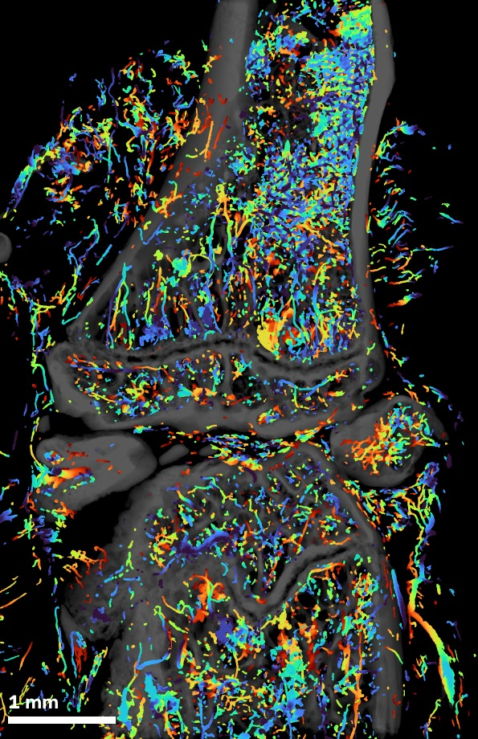
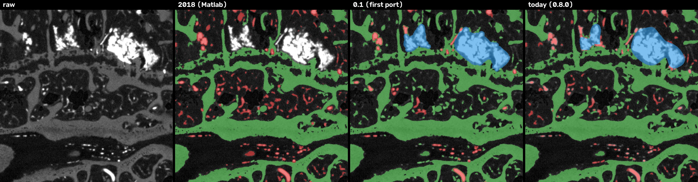
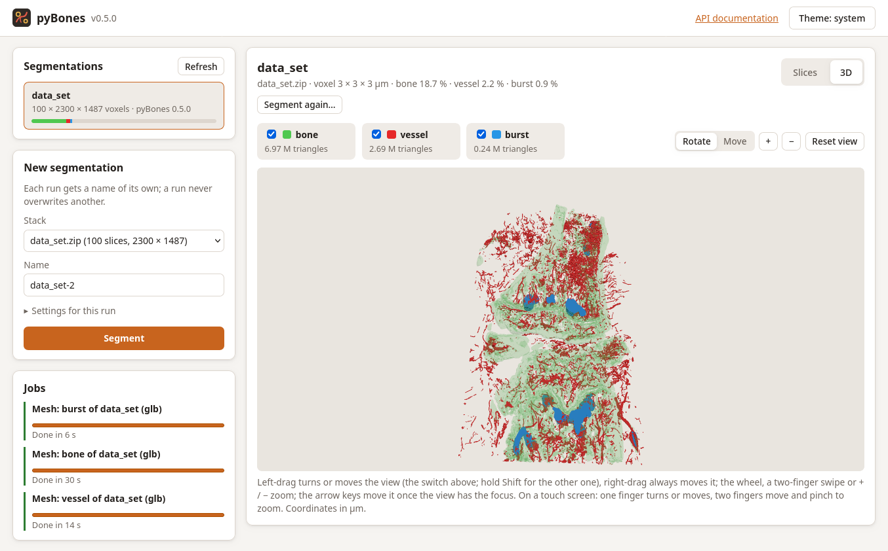
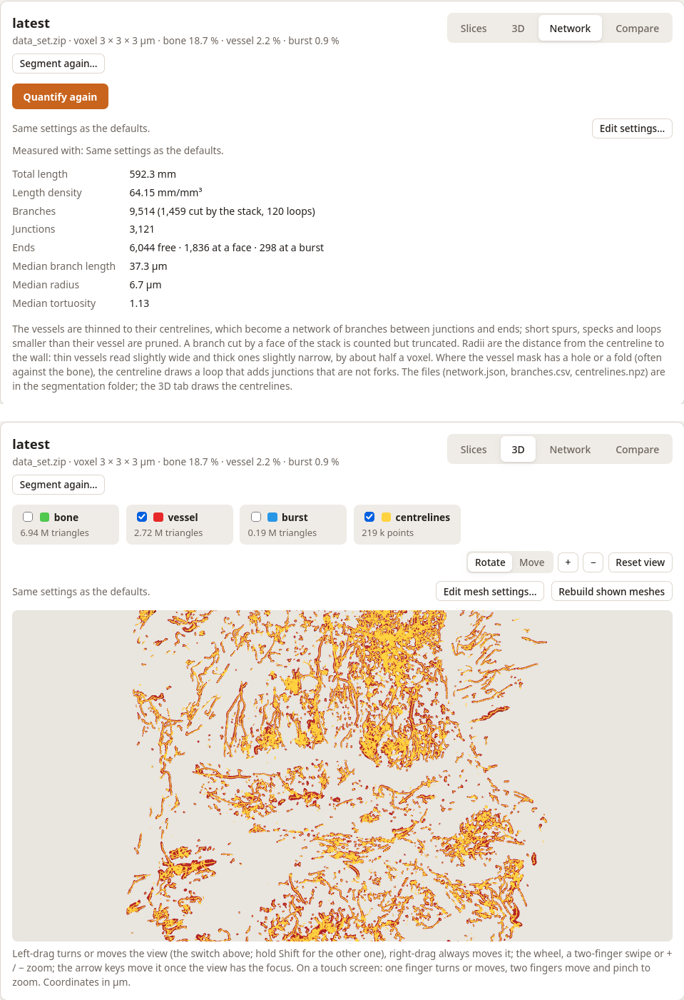

# pyBones

Back in 2018, during my engineering degree, a group project for the SAINBIOSE laboratory (Saint-Étienne)
asked us to analyse the blood vessels inside bone: a mouse knee, perfused with a radio-opaque contrast
agent (barium sulfate), scanned by micro-CT. Our answer was a Matlab segmentation script and a PyQt5
viewer. The [report](docs/report/report.pdf) summarises it, and the masks it produced are kept as the
2018 baseline in [docs/report/2018/](docs/report/2018/).

pyBones is that project, finished properly: a pure-Python rewrite (numpy + OpenCV) that splits every
voxel of the scan into **bone**, **vessel** and **burst** (contrast agent that leaked out of vessels
damaged by freezing), resolves what 2D slices cannot decide with 3D reasoning, and exports surface
meshes. With no expert annotation available, it is validated on a synthetic phantom with exact ground
truth, calibrated on the real scan.

The whole story (what the 2018 project did, what changed, why, and what is still out of reach) is in
the [report](docs/report/report.pdf).

## SCREENSHOTS

One slice of the knee (distal femur on top, proximal tibia below), segmented: bone in green, vessels in
red, bursts in blue:


The vessel network of the whole stack seen from above, coloured by depth:



The same marrow region, as segmented in 2018, by the first Python port, and today:



The synthetic phantom used for validation: image, exact ground truth, segmentation:


A local annotation page, ready for whoever can provide expert labels:


The web page (`pybones serve`): segmentations, the jobs that built the meshes, and the meshes of the
whole stack in 3D (bone see-through, vessels in red, bursts in blue):



The Network tab after measuring the sample, and its centrelines (yellow) drawn over the vessels in 3D:



## VERSION

The current version lives in [pyproject.toml](pyproject.toml) and is read from package metadata at
runtime (and recorded in every segmentation's `meta.json`). See [CHANGELOG.md](CHANGELOG.md) for the
full version history.

## TABLE OF CONTENT

<!-- TOC -->

- [pyBones](#pybones)
  - [SCREENSHOTS](#screenshots)
  - [VERSION](#version)
  - [TABLE OF CONTENT](#table-of-content)
  - [TL;DR](#tldr)
  - [INSTALLATION](#installation)
  - [HOW IT WORKS](#how-it-works)
  - [VALIDATION](#validation)
  - [PROJECT LAYOUT](#project-layout)
  - [KNOWN LIMITATIONS](#known-limitations)
  - [POSSIBLE FUTURE UPDATES](#possible-future-updates)
  - [LICENSE AND DATA](#license-and-data)

<!-- /TOC -->

## TL;DR

"I just want to see it work." With [uv](https://docs.astral.sh/uv/) and the dataset saved as
`data/data_set.zip` ([INSTALL.md](INSTALL.md#dataset)):

```sh
uv sync
uv run pybones segment data/data_set.zip -o output/run
uv run pybones preview output/run -z 50 --scale 0.5 -o slice50.png
uv run pybones mesh output/run --label vessel -o vessels.stl   # or vessels.glb
uv run pybones quantify output/run                              # vessel network, files in output/run
```

`pybones` (or `python -m pybones`) is the single entry point; see `pybones --help`.

To work from a web browser instead, start the local server (it lists the stacks of `data/`):

```sh
uv run pybones serve
```

Then open **<http://127.0.0.1:8000>** in a browser (Ctrl+C in the terminal stops the server): segment a
stack and follow its progress, scroll through its slices with the labels overlaid, turn its meshes
around in 3D, and measure its vessel network (Network tab; centrelines drawn in 3D). The HTTP API
behind the page is documented, and can be tried request by request, at
**<http://127.0.0.1:8000/docs>** (FastAPI's Swagger UI). Details: [INSTALL.md](INSTALL.md#web-server).

## INSTALLATION

Prerequisites per OS (Debian/Ubuntu, Arch Linux, Windows), installation with uv or pip, the dataset,
every command, the tools and how to build the report: [INSTALL.md](INSTALL.md), which starts with a
[from-scratch walkthrough](INSTALL.md#from-scratch).

## HOW IT WORKS

1. **Thresholds**: one 3-class Otsu (soft tissue / bone / contrast agent) for the whole stack.
2. **Per slice** (threaded, streamed): vessels are bright cores plus their partial-volume rim, cut at
   a local half-maximum against the surrounding material (sought in 3D); the glow below it is not bone.
   Bursts are areas dense in bright pixels, measured per slice and in a 3D box, bounded at half the
   core density. Small bone-intensity blobs, undecidable in 2D, are marked ambiguous.
3. **Tubularity**: a multi-scale 3D Hessian gives each ambiguous voxel a tube-vs-plate ratio.
4. **3D refinement**: ambiguous blobs are decided by what they touch in 3D (vessel, bone, nothing) and
   by their shape (a plate is never a vessel); 3D specks are removed.
5. **Meshing**: marching cubes, Taubin smoothing, STL or GLB files in µm.
6. **Vascular network** (`pybones quantify`, or the page's Network tab): the vessel mask, its
   cavities filled, is thinned to one-voxel centrelines (scikit-image); touching centreline voxels
   become a graph of branches between junctions and ends. Spurs shorter than the vessel's width,
   specks and loops barely longer than the vessel's circumference are pruned, and forks closer than
   their radii merge, in µm. Each branch gets its length, chord, tortuosity and radius (distance
   from the centreline to the wall); ends against a face of the stack or a burst are flagged, their
   branches truncated. Three files land next to the labels: `network.json` (summary and nodes),
   `branches.csv` (one row per branch) and `centrelines.npz`. On the sample: 18 s, 1.2 GB; 591 mm of
   vessels in 9,546 branches, median radius 6.7 µm.

   Its three 3D steps are interchangeable (`quantification.backends`; both give the same result,
   tested against each other and against brute force):

   | Step | Backend | Pros / cons (sample stack) |
   |---|---|---|
   | Cavities | `pybones` (default) | no extra dependency, one slice at a time; 6 s |
   | Cavities | `scipy` | one library call, 6 s here, but iterative and several full-size temporaries |
   | Centrelines | `scikit-image` | topology-preserving thinning; 10 s, ~1.1 GB (whole volume in memory) |
   | Distances | `pybones` (default) | exact, 0.4 s, one slice at a time; square pixels only |
   | Distances | `scipy` | exact for any voxel shape, an independent cross-check; ~100× slower (39 s) |

Everything is physical (µm): change `acquisition.voxel_size_um` and every kernel follows. Every value
lives in one JSON configuration, validated by pydantic.

**Mesh files.** Two settings decide how fine a mesh is, and they are independent:

- **The grid** (`mesh.downsample`, per label) is how finely the surface is built: 2 averages blocks of
  2×2×2 voxels, a 6 µm grid at 3 µm voxels (edges are still placed between grid points, but details
  smaller than a block are smoothed). 1 is full resolution, with about 4 times more triangles.
- **The storage precision** (`mesh.glb_position_bits`) is how exactly each point is written. The file
  format follows the output's extension:
  - **STL** (`.stl`), for other software (ImageJ, MeshLab, slicers): 32-bit floats, every triangle
    stored with its own corners.
  - **GLB** (`.glb`, binary glTF), for the browser (and Blender): each point stored once, loaded
    straight into the GPU. With 16-bit positions (the default), a point is rounded to a grid of
    65,535 steps across the mesh's bounding box: the error is at most half a step, a small fraction
    of a voxel on the sample (measured below); `32` stores exact floats.

<!-- meshes:start (written by python -m tools.report figures) -->
The vessel mesh of the sample (1.35 million points, 2.69 million triangles), with pyBones 0.6.0:

| Format | Size | Largest position error | Use |
|---|---|---|---|
| STL | 134.6 MB | none (32-bit floats) | other software (ImageJ, MeshLab) |
| GLB, 32-bit | 64.7 MB | none (32-bit floats) | browser, exact positions |
| GLB, 16-bit | 48.5 MB | 0.05 µm | browser (default) |
<!-- meshes:end -->

## VALIDATION

No expert ground truth exists for this scan, so [tools/phantom](tools/phantom/) renders a synthetic
µCT volume with exact labels: cortex, trabecular plates and rods, curved vessels of 3 to 25 µm radius
(some clotted, some empty), burst clusters, blurred (σ = 4.4 µm, measured on the real bone edges) and
noisy like the real scan.

<!-- scores:start (written by python -m tools.report figures) -->
| Phantom (0.6.0) | Dice | Precision | Recall |
|---|---|---|---|
| Bone | 0.989 | 0.994 | 0.984 |
| Vessel | 0.851 | 0.821 | 0.884 |
| Burst | 0.913 | 0.897 | 0.929 |
<!-- scores:end -->

Reference run on the real stack (100 x 2300 x 1487): segmentation in ~25 s with ~1.6 GB peak, on an AMD
Ryzen AI 9 HX 370 (24 logical cores, 4 worker threads), 24 GB RAM, Linux. Timings depend on the machine:
the report lists the one every timing was measured on.

## PROJECT LAYOUT

```
src/pybones/
  config/         JSON defaults + pydantic schema + loader
  io/             slice stacks (directory / zip), streamed .npy volumes, PNG export
  imaging/        binary morphology, multi-Otsu, Hessian / eigenvalues
  segmentation/   classifier, bursts, tubularity, 3D connectivity, refinement, pipeline
  meshing/        marching cubes, Taubin smoothing, STL and glTF (GLB) files
  analysis/       Dice / precision / recall
  visualization/  label overlays
  cli/            pybones command
  api/            operations as functions, background jobs (progress, cancellation, events)
  server/         local web server (FastAPI): HTTP API over api/, and the web page (static/:
                  HTML, CSS, JavaScript modules, three.js 0.187 vendored)
tools/            annotation page, synthetic phantom, report benchmark & figures, check runner
tests/            mirrors src/ and tools/ (pytest, synthetic data)
docs/report/      the report (LaTeX); 2018/ holds the 2018 masks and images it compares against
```

## KNOWN LIMITATIONS

**Results**

- **Voxel size**: unknown; 3 µm isotropic is an estimate (anatomy and the 2018 project brief agree).
- **Thin vessels**: below ~6 µm radius, a vessel is smaller than the scanner blur; about 4 in 10 are
  found. Measured diameters under ~12 µm will be overestimated.
- **Vessels and bone look alike**: even the researchers could not always tell them apart on this scan.
  The segmentation is a best effort, not a ground truth.
- **Freezer damage**: the femur was frozen, so burst vessels and leaked or clotted contrast agent are
  part of the data; bursts are labelled as such, clotted segments leave gaps in the network.
- **No expert validation**: the phantom is realistic but synthetic. The annotation tool is ready for
  anyone who can label real crops.
- **One sample**: pyBones has only ever seen this one scan.

**Vascular network**

- **Junctions that are not forks**: wherever the vessel mask has a hole or a fold, the centreline goes
  around it and draws a loop, and each loop adds about two junctions. On the phantom, the holes come
  from bursts (the edge of a burst takes the bright core of a thick vessel passing close by) and the
  folds from bone (where a vessel presses against it, its mask runs along the bone's surface). Loops
  barely longer than their vessel's circumference are removed (real loops are several times longer);
  on the network phantom, the measured junctions of the segmentation are still mostly not forks (24
  of 54 true forks found, 59 others; chapter 6 of the report). Counts of junctions and branches are
  therefore upper bounds.
- **Lengths carry two opposite errors**: about 8 % short on the phantom, mostly from the thin vessels
  missed; strands doubled around holes would lengthen them, but most go with the small loops.
- **Radius bias depends on the calibre**: thin vessels read about 0.8 µm too wide, thick ones about
  1.5 µm too narrow, so no single correction applies and none is made. Radii also come in steps of
  the voxel grid (√k × 3 µm).
- **Crossings look like forks**: two vessels touching in the mask are joined in the network.
- **Branches cut by the stack** are counted but truncated (flagged in `branches.csv`): on a 300 µm
  thick stack, many are.
- **Spurs are judged at their fork**: a branch shorter than about twice the widest radius at its
  junction is taken for a bump of the surface. Short real side branches of thick vessels are lost;
  forks are not invented.
- **Whole stack only**: no regions (cortex, marrow) yet.

**Other scans**

- **Preparation**: the thresholds are computed from each scan (3-class Otsu), and every size is in µm,
  so another resolution or brightness range only needs configuration changes. But the method assumes
  three intensity classes, background < bone < vessel: vessels must be the brightest material
  (barium or another strongly radio-opaque agent) and the bone must not be decalcified. A scan where
  the contrast agent looks dimmer than bone would need code changes, not settings.
- **One set of thresholds per stack**: they are estimated once for the whole stack, so a scan whose
  brightness drifts from one end to the other is classified with thresholds that fit neither end.
- **Fixed rules**: a vessel is a bright core with a rim, a tube rather than a plate; bone is large,
  connected material; a burst is an area dense in bright speckles (freezer damage). The numbers behind
  these rules are settings, the rules themselves are code: tissue that does not look like this is
  misclassified.
- **Values tuned on one sample**: the minimum sizes, the burst density and the tubularity cut-off were
  chosen on this scan (and on a phantom calibrated on it). Another scan will likely need them adjusted,
  and there is no automatic way to check the result without a reference.
- **Voxel size must be known**: every size goes through `acquisition.voxel_size_um`; a wrong value
  scales every rule, and the meshes, by the same error.
- **No ground truth**: a public scan rarely comes with vessel annotations or measurements; without
  them, segmenting it gives one more sample to look at, not a measured accuracy.
- **Format**: 16-bit grey-level slices (TIFF or PNG), one file per slice, in a folder or a zip
  archive, ordered by their file names (`slice_2` before `slice_10`).
- **Size**: the stack is streamed, but memory still grows with it (~1.6 GB peak for the 100 × 2300 ×
  1487 sample).
- **Older segmentations**: pyBones only reads the outputs of its own version's format; an output
  written by an older version is refused with a message naming both versions. Segment the stack
  again (~25 s for the sample): while the project is alpha, outputs are not kept compatible.

**Web server**

- **Local only**: no login and no access control; it listens on `127.0.0.1` and must stay there.
- **No upload**: stacks are read from the data folder on the server's own disk.
- **A recent browser**: the page needs JavaScript modules, import maps and WebGL 2 (current Firefox,
  Chrome, Edge or Safari). Without WebGL, the 3D tab says so and the rest works.
- **Large meshes**: the full vessel and bone meshes of the sample weigh tens to over a hundred MB even
  as 16-bit GLB (see [Mesh files](#how-it-works), and Table 4.1 of the report for every label). The
  page keeps them in GPU memory only, and the bone is off by default, but a modest graphics card may
  struggle with all three. The 6 µm grid (`mesh.downsample` 2) is already a compromise: full
  resolution quadruples it. Nothing is compressed: on the local machine, compressing would take
  longer than sending.
- **Jobs live in memory**: stopping the server cancels the running jobs and forgets the finished
  ones (their results stay on disk). The page remembers the last segmentation viewed in this browser
  only.
- **One job at a time** by default (`jobs.max_concurrent`): a segmentation takes ~1.6 GB of RAM.
- **Browser caches**: the page's files are checked on every load, so an update is never missed; a
  browser that kept them before this rule (pyBones 0.5) may need one hard refresh (Ctrl+Shift+R).
- **Centrelines in 3D** are drawn as points over the meshes, one pixel each: zoomed out, the whole
  stack's centrelines (about 220,000 points on the sample) cover much of the view.
- **Cached meshes are not rebuilt by themselves**: a mesh is built once per label and format and kept
  next to its segmentation; after changing the mesh settings (grid, smoothing, precision), build it
  again (`POST` its address) to refresh it.

## POSSIBLE FUTURE UPDATES

- Vascular network: telling a thick vessel from a burst, and a vessel from the bone, where they touch
  (the holes and folds they leave are the main source of junctions that are not forks), and measures
  per region (cortex, marrow).
- Bridging small vessel gaps (clots) along the vessel direction.
- Web page: the raw slice without overlay, measurements in 3D (distances, a picked vessel's calibre),
  and the configuration of a run as a form built from its schema (`GET /api/config/schema`).

## LICENSE AND DATA

The **source code** is released under the [MIT License](LICENSE).

The **data are not covered by that license.** The micro-CT stack (`data_set.zip`, linked from
[INSTALL.md](INSTALL.md#dataset)) was acquired in 2017 by the SAINBIOSE laboratory (U1059,
Saint-Étienne) and handed to a group of engineering students for a school project. The same applies
to everything derived from it in this repository: the report figures, the README screenshots, the
segmentation extracts (`docs/report/data/runs/`) and the 2018 project images (`docs/report/2018/`).

They are shared for research and educational purposes only, without any warranty, and all rights
remain with their owners. The original researchers could not be reached to confirm the terms of
use: if you hold rights to these data and want them removed, please open an issue and they will be
taken down.
